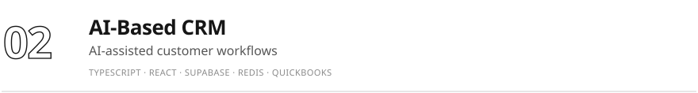
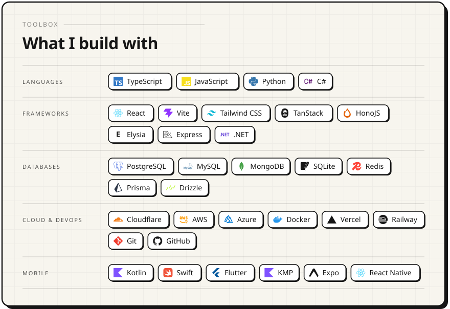
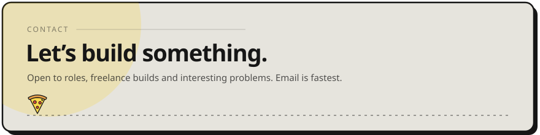

<picture><source media="(prefers-color-scheme: dark)" srcset="assets/hero-dark.svg" /></picture>

<a href="https://seanti.is-a.dev"><picture><source media="(prefers-color-scheme: dark)" srcset="assets/btn-site-dark.svg" /></picture></a>
<a href="https://linkedin.com/in/sean-godric-reyes"><picture><source media="(prefers-color-scheme: dark)" srcset="assets/btn-linkedin-dark.svg" /></picture></a>
<a href="mailto:seangodric@gmail.com"><picture><source media="(prefers-color-scheme: dark)" srcset="assets/btn-email-dark.svg" /></picture></a>
<picture><source media="(prefers-color-scheme: dark)" srcset="assets/btn-views-dark.svg" /></picture>

I’m Sean Godric Reyes, Seanti for short. I turn messy real-world problems into clean, fast full-stack products, on the web and on phones.

 

<picture><source media="(prefers-color-scheme: dark)" srcset="assets/work-head-dark.svg" /></picture>
<a href="https://humanzlab.com"><picture><source media="(prefers-color-scheme: dark)" srcset="assets/work-humanzlab-dark.svg" /></picture></a>
<picture><source media="(prefers-color-scheme: dark)" srcset="assets/work-crm-dark.svg" /></picture>
<picture><source media="(prefers-color-scheme: dark)" srcset="assets/work-sellout-dark.svg" /></picture>

 

<picture><source media="(prefers-color-scheme: dark)" srcset="assets/stack-dark.svg" /></picture>

  

<a href="mailto:seangodric@gmail.com"><picture><source media="(prefers-color-scheme: dark)" srcset="assets/footer-dark.svg" /></picture></a>
